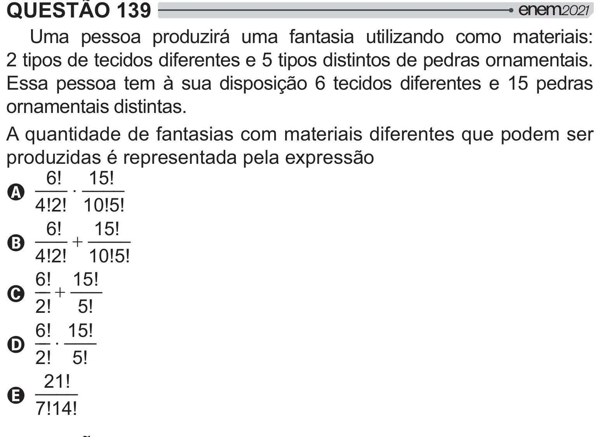

Texto extraído (pode conter ruído)

QUESTÃO 139  
Uma pessoa produzirá uma fantasia utilizando como materiais:  
2 tipos de tecidos diferentes e 5 tipos distintos de pedras ornamentais.  
Essa pessoa tem à sua disposição 6 tecidos diferentes e 15 pedras  
ornamentais distintas.  
A quantidade de fantasias com materiais diferentes que podem ser  
produzidas é representada pela expressão  
6! ____  
15!  
___  
˜  
A  
4!2! 10!5!  
6! ____  
15!  
___  
  
B  
4!2! 10!5!  
6!  
15!  
__  ___  
C  
2! 5!  
6!  
15!  
__ ˜ ___  
D  
2! 5!  
21!  
____  
E  
7!14!

