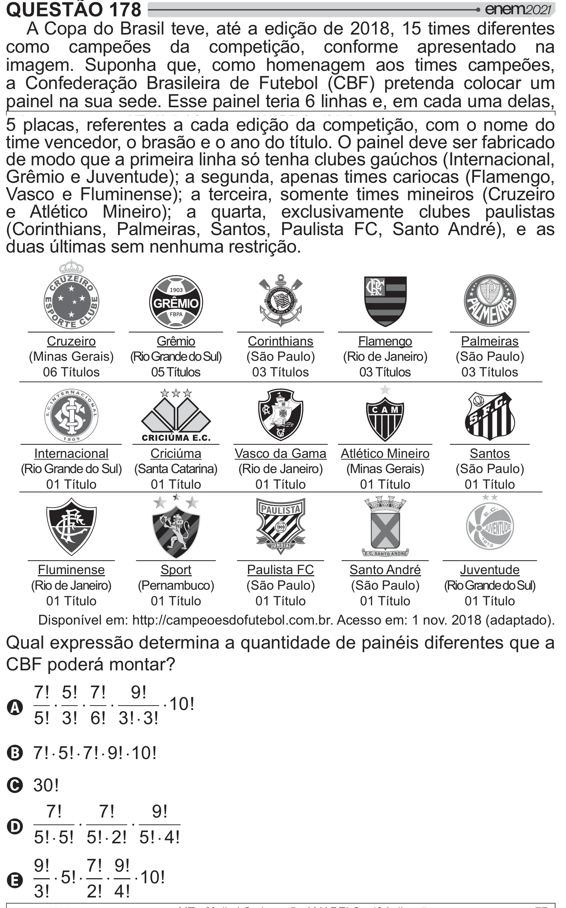

Texto extraído (pode conter ruído)

QUESTÃO 178  
A Copa do Brasil teve, até a edição de 2018, 15 times diferentes  
como campeões da competição, conforme apresentado na  
imagem. Suponha que, como homenagem aos times campeões,  
a Confederação Brasileira de Futebol (CBF) pretenda colocar um  
painel na sua sede. Esse painel teria 6 linhas e, em cada uma delas,  
5 placas, referentes a cada edição da competição, com o nome do  
time vencedor, o brasão e o ano do título. O painel deve ser fabricado  
de modo que a primeira linha só tenha clubes gaúchos (Internacional,  
Grêmio e Juventude); a segunda, apenas times cariocas (Flamengo,  
Vasco e Fluminense); a terceira, somente times mineiros (Cruzeiro  
e Atlético Mineiro); a quarta, exclusivamente clubes paulistas  
(Corinthians, Palmeiras, Santos, Paulista FC, Santo André), e as  
duas últimas sem nenhuma restrição.  
____________  
_____________  
____________  
_____________  
___________  
Cruzeiro  
Grêmio  
Corinthians  
Flamengo  
Palmeiras  
(Minas Gerais)  
(Rio Grande do Sul)  
(São Paulo)  
(Rio de Janeiro)  
(São Paulo)  
06 Títulos  
05 Títulos  
03 Títulos  
03 Títulos  
03 Títulos  
_  
______________ ____________  
_____________ _____________  
___________  
Internacional  
Criciúma  
Vasco da Gama Atlético Mineiro  
Santos  
(Rio Grande do Sul) (Santa Catarina)  
(Rio de Janeiro)  
(Minas Gerais)  
(São Paulo)  
01 Título  
01 Título  
01 Título  
01 Título  
01 Título  
____________  
___________  
____________ ____________ _____________  
Fluminense  
Sport  
Paulista FC  
Santo André  
Juventude  
(Rio de Janeiro)  
(Pernambuco)  
(São Paulo)  
(São Paulo)  
(Rio Grande do Sul)  
01 Título  
01 Título  
01 Título  
01 Título  
01 Título  
Disponível em: http://campeoesdofutebol.com.br. Acesso em: 1 nov. 2018 (adaptado).  
Qual expressão determina a quantidade de painéis diferentes que a  
šÀ# / ]  
7 ! 5 ! 7 ! 9 !  
A  
10 !  
5 ! 3 ! 6 ! 3 ! 3 !  
B 7 ! 5 ! 7 ! 9 ! 10 !  
C 30!  
7 !  
7 !  
9 !  
D  
5 ! 5 ! 5 ! 2 ! 5 ! 4 !  
9 !  
7 ! 9 !  
E  
5 !  
10 !  
3 !  
2 ! 4 !

