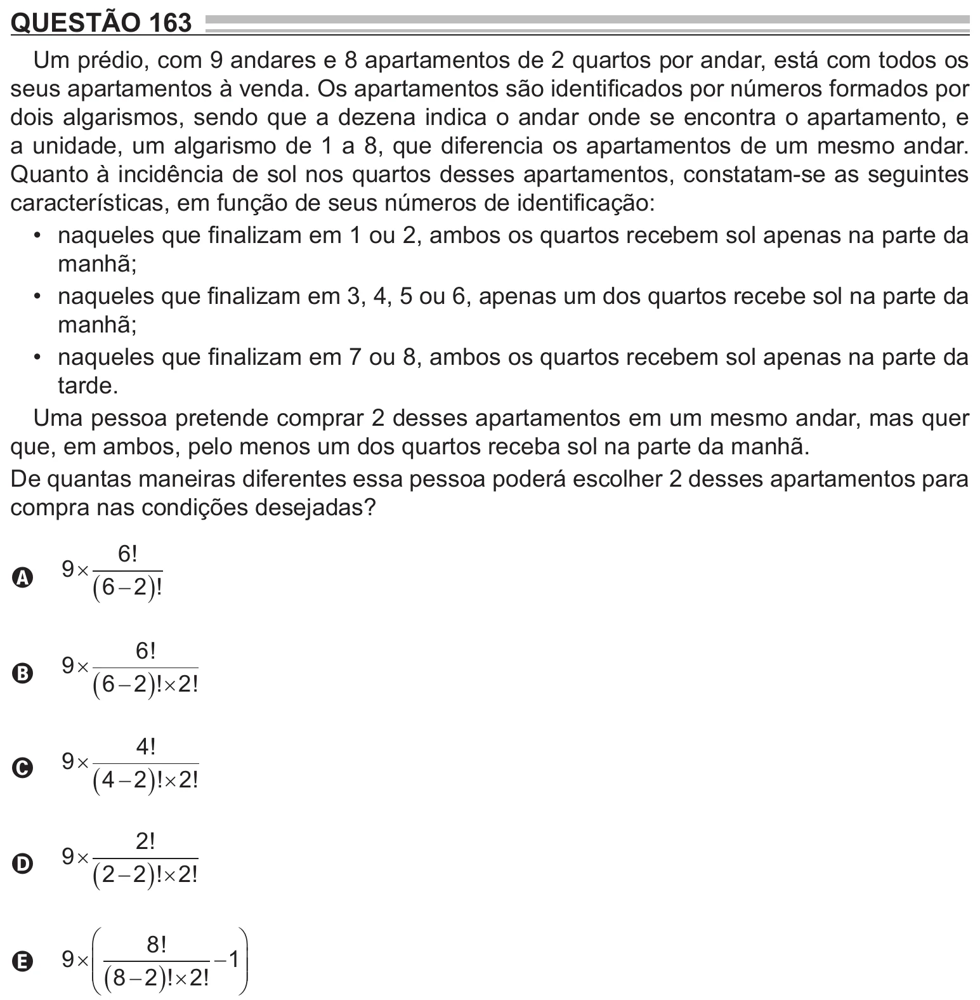

Texto extraído (pode conter ruído)

QUESTÃO 163  
Um prédio, com 9 andares e 8 apartamentos de 2 quartos por andar, está com todos os  
seus apartamentos à venda. Os apartamentos são identificados por números formados por  
dois algarismos, sendo que a dezena indica o andar onde se encontra o apartamento, e  
a unidade, um algarismo de 1 a 8, que diferencia os apartamentos de um mesmo andar.  
Quanto à incidência de sol nos quartos desses apartamentos, constatam-se as seguintes  
características, em função de seus números de identificação:  
• naqueles que finalizam em 1 ou 2, ambos os quartos recebem sol apenas na parte da  
manhã;  
• naqueles que finalizam em 3, 4, 5 ou 6, apenas um dos quartos recebe sol na parte da  
manhã;  
• naqueles que finalizam em 7 ou 8, ambos os quartos recebem sol apenas na parte da  
tarde.  
Uma pessoa pretende comprar 2 desses apartamentos em um mesmo andar, mas quer  
que, em ambos, pelo menos um dos quartos receba sol na parte da manhã.  
De quantas maneiras diferentes essa pessoa poderá escolher 2 desses apartamentos para  
compra nas condições desejadas?  
6 !  
9   
A  
 6  2  !  
6 !  
9   
B  
 6  2  !  2 !  
4 !  
9   
C  
 4  2  !  2 !  
2 !  
9   
D  
 2  2  !  2 !  
  
8 !  
  
9    
 1   
E  
  8  2  !  2 !

