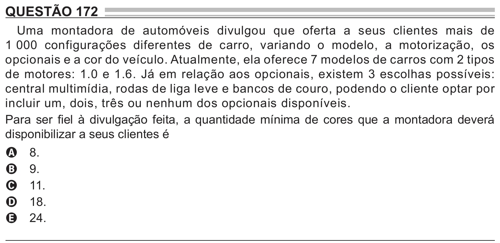

Texto extraído (pode conter ruído)

QUESTÃO 172  
Uma montadora de automóveis divulgou que oferta a seus clientes mais de  
1 000 configurações diferentes de carro, variando o modelo, a motorização, os  
opcionais e a cor do veículo. Atualmente, ela oferece 7 modelos de carros com 2 tipos  
de motores: 1.0 e 1.6. Já em relação aos opcionais, existem 3 escolhas possíveis:  
central multimídia, rodas de liga leve e bancos de couro, podendo o cliente optar por  
incluir um, dois, três ou nenhum dos opcionais disponíveis.  
Para ser fiel à divulgação feita, a quantidade mínima de cores que a montadora deverá  
disponibilizar a seus clientes é  
8.  
A  
9.  
B  
11.  
C  
18.  
D  
24.  
E

