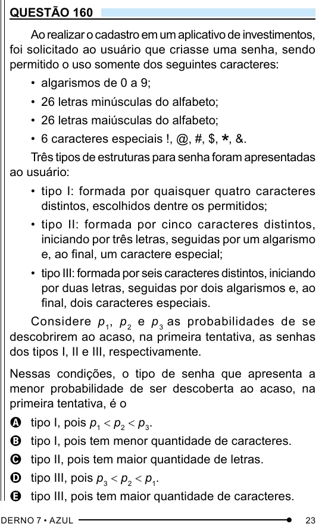

Texto extraído (pode conter ruído)

QUESTÃO 160  
Ao realizar o cadastro em um aplicativo de investimentos,  
foi solicitado ao usuário que criasse uma senha, sendo  
permitido o uso somente dos seguintes caracteres:  
• algarismos de 0 a 9;  
• 26 letras minúsculas do alfabeto;  
• 26 letras maiúsculas do alfabeto;  
• 6 caracteres especiais !, @, #, $, , &.  
Três tipos de estruturas para senha foram apresentadas  
ao usuário:  
• tipo I: formada por quaisquer quatro caracteres  
distintos, escolhidos dentre os permitidos;  
• tipo II: formada por cinco caracteres distintos,  
iniciando por três letras, seguidas por um algarismo  
e, ao final, um caractere especial;  
• tipo III: formada por seis caracteres distintos, iniciando  
por duas letras, seguidas por dois algarismos e, ao  
final, dois caracteres especiais.  
Considere p 1 , p 2 e p 3 as probabilidades de se  
descobrirem ao acaso, na primeira tentativa, as senhas  
dos tipos I, II e III, respectivamente.  
Nessas condições, o tipo de senha que apresenta a  
menor probabilidade de ser descoberta ao acaso, na  
primeira tentativa, é o  
A tipo I, pois p 1 < p 2 < p 3 .  
B tipo I, pois tem menor quantidade de caracteres.  
C tipo II, pois tem maior quantidade de letras.  
D tipo III, pois p 3 < p 2 < p 1 .  
E tipo III, pois tem maior quantidade de caracteres.

