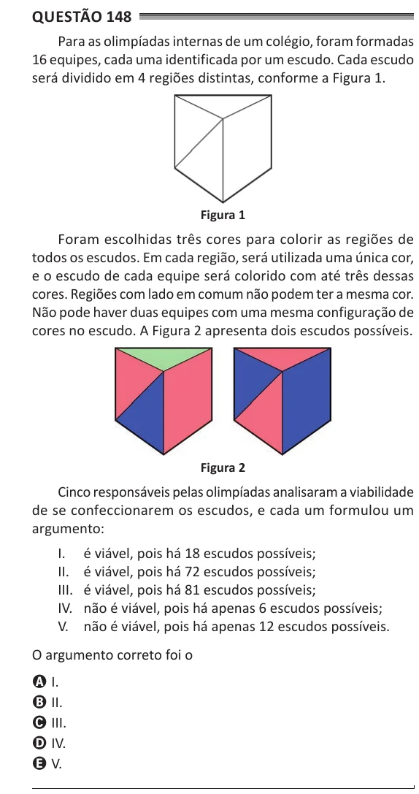

Texto extraído (pode conter ruído)

Questão 148  
Para as olimpíadas internas de um colégio, foram formadas  
16 equipes, cada uma identificada por um escudo. Cada escudo  
será dividido em 4 regiões distintas, conforme a Figura 1.  
Figura 1  
Foram escolhidas três cores para colorir as regiões de  
todos os escudos. Em cada região, será utilizada uma única cor,  
e o escudo de cada equipe será colorido com até três dessas  
cores. Regiões com lado em comum não podem ter a mesma cor.  
Não pode haver duas equipes com uma mesma configuração de  
cores no escudo. A Figura 2 apresenta dois escudos possíveis.  
Figura 2  
Cinco responsáveis pelas olimpíadas analisaram a viabilidade  
de se confeccionarem os escudos, e cada um formulou um  
argumento:  
I. é viável, pois há 18 escudos possíveis;  
II. é viável, pois há 72 escudos possíveis;  
III. é viável, pois há 81 escudos possíveis;  
IV. não é viável, pois há apenas 6 escudos possíveis;  
V. não é viável, pois há apenas 12 escudos possíveis.  
O argumento correto foi o  
A I.  
B II.  
C III.  
D IV.  
E V.

