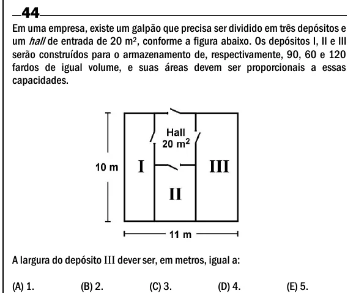

Texto extraído (pode conter ruído)

44  
Em uma empresa, existe um galpão que precisa ser dividido em três depósitos e  
um hall de entrada de 20 m 2 , conforme a figura abaixo. Os depósitos I, II e III  
serão construídos para o armazenamento de, respectivamente, 90, 60 e 120  
fardos de igual volume, e suas áreas devem ser proporcionais a essas  
capacidades.  
A largura do depósito III dever ser, em metros, igual a:  
(A) 1.  
(B) 2.  
(C) 3.  
(D) 4.  
(E) 5.

