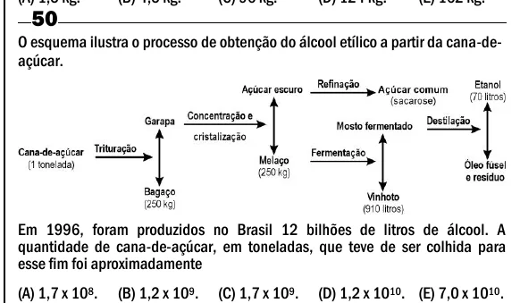

Texto extraído (pode conter ruído)

50  
O esquema ilustra o processo de obtenção do álcool etílico a partir da cana-de-  
açúcar.  
Em 1996, foram produzidos no Brasil 12 bilhões de litros de álcool. A  
quantidade de cana-de-açúcar, em toneladas, que teve de ser colhida para  
esse fim foi aproximadamente  
(A) 1,7 x 10 8 .  
(B) 1,2 x 10 9 .  
(C) 1,7 x 10 9 .  
(D) 1,2 x 10 10 . (E) 7,0 x 10 10 .

