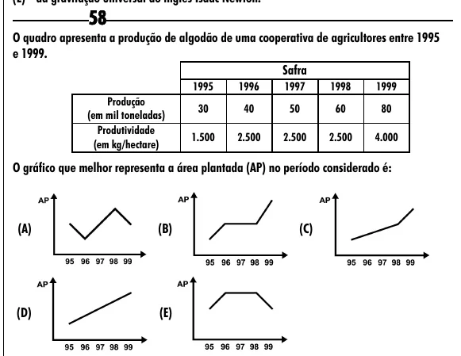

Texto extraído (pode conter ruído)

58  
O quadro apresenta a produção de algodão de uma cooperativa de agricultores entre 1995  
e 1999.  
Safra  
1995  
1996  
1997  
1998  
1999  
Produção  
30  
40  
50  
60  
80  
(em mil toneladas)  
Produtividade  
1.500  
2.500  
2.500  
2.500  
4.000  
(em kg/hectare)  
O gráfico que melhor representa a área plantada (AP) no período considerado é:  
(A)  
(B)  
(C)  
(D)  
(E)

