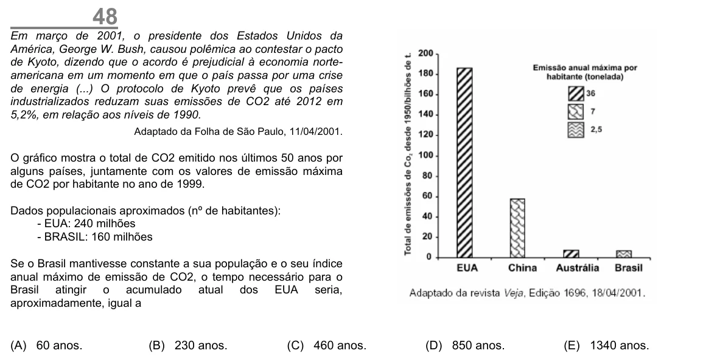

Texto extraído (pode conter ruído)

48  
Em março de 2001, o presidente dos Estados Unidos da  
América, George W. Bush, causou polêmica ao contestar o pacto  
de Kyoto, dizendo que o acordo é prejudicial à economia norte-  
americana em um momento em que o país passa por uma crise  
de energia (...) O protocolo de Kyoto prevê que os países  
industrializados reduzam suas emissões de CO2 até 2012 em  
5,2%, em relação aos níveis de 1990.  
Adaptado da Folha de São Paulo, 11/04/2001.  
O gráfico mostra o total de CO2 emitido nos últimos 50 anos por  
alguns países, juntamente com os valores de emissão máxima  
de CO2 por habitante no ano de 1999.  
Dados populacionais aproximados (nº de habitantes):  
- EUA: 240 milhões  
- BRASIL: 160 milhões  
Se o Brasil mantivesse constante a sua população e o seu índice  
anual máximo de emissão de CO2, o tempo necessário para o  
Brasil atingir o acumulado atual dos EUA seria,  
aproximadamente, igual a  
(A) 60 anos.  
(B) 230 anos.  
(C) 460 anos.  
(D) 850 anos.  
(E) 1340 anos.

