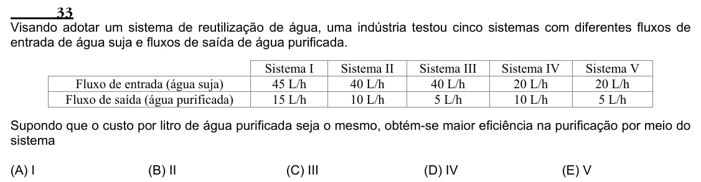

Texto extraído (pode conter ruído)

33  
Visando adotar um sistema de reutilização de água, uma indústria testou cinco sistemas com diferentes fluxos de  
entrada de água suja e fluxos de saída de água purificada.  
Sistema I  
Sistema II  
Sistema III  
Sistema IV  
Sistema V  
Fluxo de entrada (água suja)  
45 L/h  
40 L/h  
40 L/h  
20 L/h  
20 L/h  
Fluxo de saída (água purificada)  
15 L/h  
10 L/h  
5 L/h  
10 L/h  
5 L/h  
Supondo que o custo por litro de água purificada seja o mesmo, obtém-se maior eficiência na purificação por meio do  
sistema  
(A) I  
(B) II  
(C) III  
(D) IV  
(E) V

