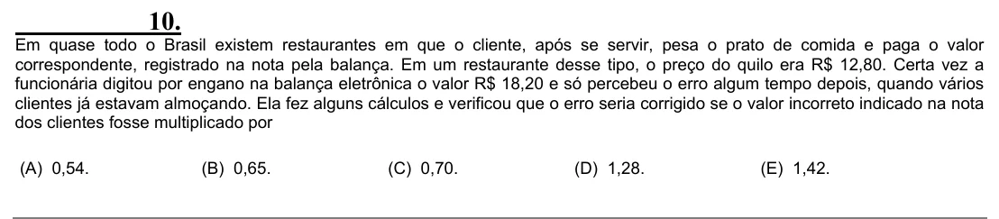

Texto extraído (pode conter ruído)

10.  
Em quase todo o Brasil existem restaurantes em que o cliente, após se servir, pesa o prato de comida e paga o valor  
correspondente, registrado na nota pela balança. Em um restaurante desse tipo, o preço do quilo era R$ 12,80. Certa vez a  
funcionária digitou por engano na balança eletrônica o valor R$ 18,20 e só percebeu o erro algum tempo depois, quando vários  
clientes já estavam almoçando. Ela fez alguns cálculos e verificou que o erro seria corrigido se o valor incorreto indicado na nota  
dos clientes fosse multiplicado por  
(A) 0,54.  
(B) 0,65.  
(C) 0,70.  
(D) 1,28.  
(E) 1,42.

