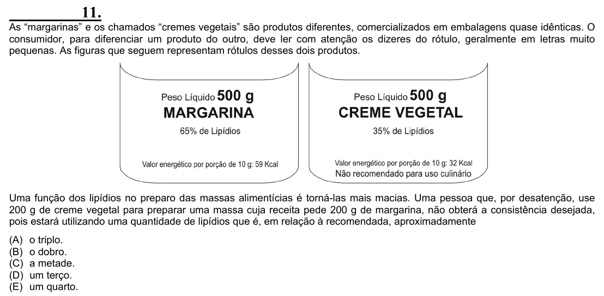

Texto extraído (pode conter ruído)

11.  
As “margarinas” e os chamados “cremes vegetais” são produtos diferentes, comercializados em embalagens quase idênticas. O  
consumidor, para diferenciar um produto do outro, deve ler com atenção os dizeres do rótulo, geralmente em letras muito  
pequenas. As figuras que seguem representam rótulos desses dois produtos.  
Uma função dos lipídios no preparo das massas alimentícias é torná-las mais macias. Uma pessoa que, por desatenção, use  
200 g de creme vegetal para preparar uma massa cuja receita pede 200 g de margarina, não obterá a consistência desejada,  
pois estará utilizando uma quantidade de lipídios que é, em relação à recomendada, aproximadamente  
(A) o triplo.  
(B) o dobro.  
(C) a metade.  
(D) um terço.  
(E) um quarto.

