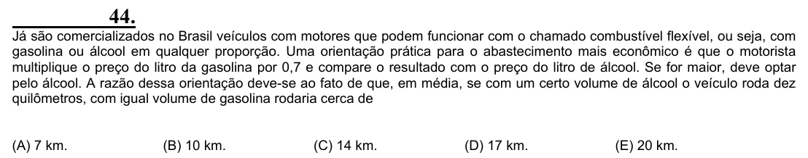

Texto extraído (pode conter ruído)

44.  
Já são comercializados no Brasil veículos com motores que podem funcionar com o chamado combustível flexível, ou seja, com  
gasolina ou álcool em qualquer proporção. Uma orientação prática para o abastecimento mais econômico é que o motorista  
multiplique o preço do litro da gasolina por 0,7 e compare o resultado com o preço do litro de álcool. Se for maior, deve optar  
pelo álcool. A razão dessa orientação deve-se ao fato de que, em média, se com um certo volume de álcool o veículo roda dez  
quilômetros, com igual volume de gasolina rodaria cerca de  
(A) 7 km.  
(B) 10 km.  
(C) 14 km.  
(D) 17 km.  
(E) 20 km.

