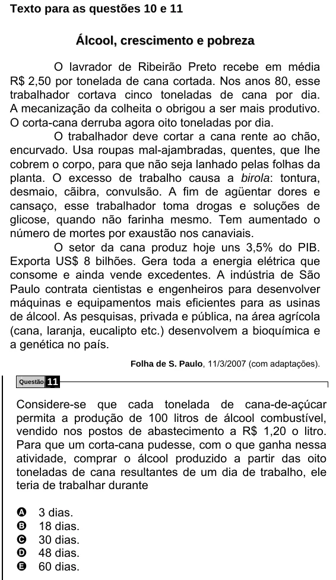

Texto extraído (pode conter ruído)

Texto para as questões 10 e 11  
Á l c o o l , c r e s c i m e n t o e p o b r e z a  
O lavrador de Ribeirão Preto recebe em média  
R$ 2,50 por tonelada de cana cortada. Nos anos 80, esse  
trabalhador cortava cinco toneladas de cana por dia.  
A mecanização da colheita o obrigou a ser mais produtivo.  
O corta-cana derruba agora oito toneladas por dia.  
O trabalhador deve cortar a cana rente ao chão,  
encurvado. Usa roupas mal-ajambradas, quentes, que lhe  
cobrem o corpo, para que não seja lanhado pelas folhas da  
planta. O excesso de trabalho causa a birola: tontura,  
desmaio, cãibra, convulsão. A fim de agüentar dores e  
cansaço, esse trabalhador toma drogas e soluções de  
glicose, quando não farinha mesmo. Tem aumentado o  
número de mortes por exaustão nos canaviais.  
O setor da cana produz hoje uns 3,5% do PIB.  
Exporta US$ 8 bilhões. Gera toda a energia elétrica que  
consome e ainda vende excedentes. A indústria de São  
Paulo contrata cientistas e engenheiros para desenvolver  
máquinas e equipamentos mais eficientes para as usinas  
de álcool. As pesquisas, privada e pública, na área agrícola  
(cana, laranja, eucalipto etc.) desenvolvem a bioquímica e  
a genética no país.  
Folha de S. Paulo, 11/3/2007 (com adaptações).  
Questão  
11  
Considere-se que cada tonelada de cana-de-açúcar  
permita a produção de 100 litros de álcool combustível,  
vendido nos postos de abastecimento a R$ 1,20 o litro.  
Para que um corta-cana pudesse, com o que ganha nessa  
atividade, comprar o álcool produzido a partir das oito  
toneladas de cana resultantes de um dia de trabalho, ele  
teria de trabalhar durante  
A  
3 dias.  
B  
18 dias.  
30 dias.  
C  
D  
48 dias.  
E  
60 dias.

