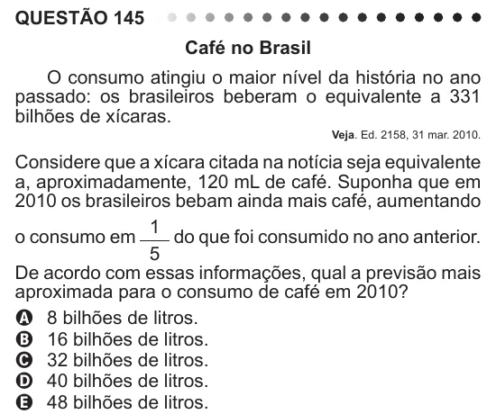

Texto extraído (pode conter ruído)

QUESTÃO 145  
Café no Brasil  
O consumo atingiu o maior nível da história no ano  
passado: os brasileiros beberam o equivalente a 331  
bilhões de xícaras.  
Veja. Ed. 2158, 31 mar. 2010.  
Considere que a xícara citada na notícia seja equivalente  
a, aproximadamente, 120 mL de café. Suponha que em  
2010 os brasileiros bebam ainda mais café, aumentando  
1  
o consumo em  
do que foi consumido no ano anterior.  
5  
De acordo com essas informações, qual a previsão mais  
aproximada para o consumo de café em 2010?  
A 8 bilhões de litros.  
B 16 bilhões de litros.  
C 32 bilhões de litros.  
D 40 bilhões de litros.  
E 48 bilhões de litros.

