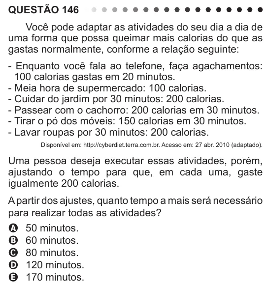

Texto extraído (pode conter ruído)

QUESTÃO 146  
Você pode adaptar as atividades do seu dia a dia de  
uma forma que possa queimar mais calorias do que as  
gastas normalmente, conforme a relação seguinte:  
- Enquanto você fala ao telefone, faça agachamentos:  
100 calorias gastas em 20 minutos.  
- Meia hora de supermercado: 100 calorias.  
- Cuidar do jardim por 30 minutos: 200 calorias.  
- Passear com o cachorro: 200 calorias em 30 minutos.  
- Tirar o pó dos móveis: 150 calorias em 30 minutos.  
- Lavar roupas por 30 minutos: 200 calorias.  
Disponível em: http://cyberdiet.terra.com.br. Acesso em: 27 abr. 2010 (adaptado).  
Uma pessoa deseja executar essas atividades, porém,  
ajustando o tempo para que, em cada uma, gaste  
igualmente 200 calorias.  
A partir dos ajustes, quanto tempo a mais será necessário  
para realizar todas as atividades?  
A 50 minutos.  
B 60 minutos.  
C 80 minutos.  
D 120 minutos.  
E 170 minutos.

