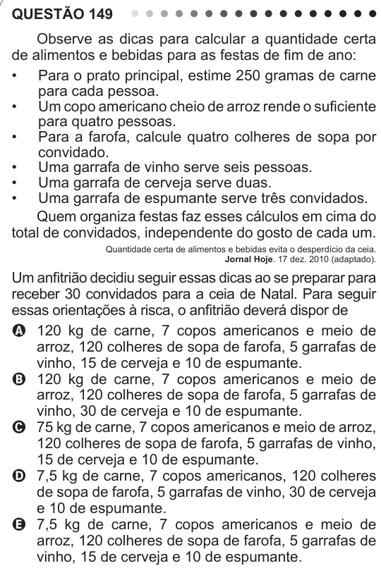

Texto extraído (pode conter ruído)

QUESTÃO 149  
Observe as dicas para calcular a quantidade certa  
de alimentos e bebidas para as festas de fim de ano:  
• Para o prato principal, estime 250 gramas de carne  
para cada pessoa.  
• Um copo americano cheio de arroz rende o suficiente  
para quatro pessoas.  
• Para a farofa, calcule quatro colheres de sopa por  
convidado.  
• Uma garrafa de vinho serve seis pessoas.  
• Uma garrafa de cerveja serve duas.  
• Uma garrafa de espumante serve três convidados.  
Quem organiza festas faz esses cálculos em cima do  
total de convidados, independente do gosto de cada um.  
Quantidade certa de alimentos e bebidas evita o desperdício da ceia.  
Jornal Hoje. 17 dez. 2010 (adaptado).  
Um anfitrião decidiu seguir essas dicas ao se preparar para  
receber 30 convidados para a ceia de Natal. Para seguir  
essas orientações à risca, o anfitrião deverá dispor de  
A 120 kg de carne, 7 copos americanos e meio de  
arroz, 120 colheres de sopa de farofa, 5 garrafas de  
vinho, 15 de cerveja e 10 de espumante.  
B 120 kg de carne, 7 copos americanos e meio de  
arroz, 120 colheres de sopa de farofa, 5 garrafas de  
vinho, 30 de cerveja e 10 de espumante.  
C 75 kg de carne, 7 copos americanos e meio de arroz,  
120 colheres de sopa de farofa, 5 garrafas de vinho,  
15 de cerveja e 10 de espumante.  
D 7,5 kg de carne, 7 copos americanos, 120 colheres  
de sopa de farofa, 5 garrafas de vinho, 30 de cerveja  
e 10 de espumante.  
E 7,5 kg de carne, 7 copos americanos e meio de  
arroz, 120 colheres de sopa de farofa, 5 garrafas de  
vinho, 15 de cerveja e 10 de espumante.

