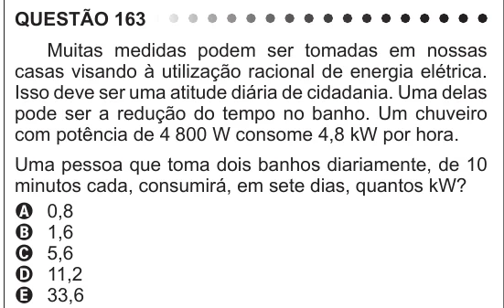

Texto extraído (pode conter ruído)

QUESTÃO 163  
Muitas medidas podem ser tomadas em nossas  
casas visando à utilização racional de energia elétrica.  
Isso deve ser uma atitude diária de cidadania. Uma delas  
pode ser a redução do tempo no banho. Um chuveiro  
com potência de 4 800 W consome 4,8 kW por hora.  
Uma pessoa que toma dois banhos diariamente, de 10  
minutos cada, consumirá, em sete dias, quantos kW?  
A 0,8  
B 1,6  
C 5,6  
D 11,2  
E 33,6

