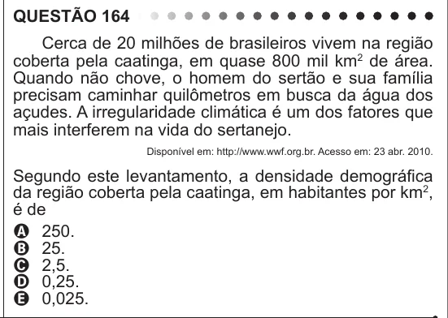

Texto extraído (pode conter ruído)

QUESTÃO 164  
Cerca de 20 milhões de brasileiros vivem na região  
coberta pela caatinga, em quase 800 mil km 2 de área.  
Quando não chove, o homem do sertão e sua família  
precisam caminhar quilômetros em busca da água dos  
açudes. A irregularidade climática é um dos fatores que  
mais interferem na vida do sertanejo.  
Disponível em: http://www.wwf.org.br. Acesso em: 23 abr. 2010.  
Segundo este levantamento, a densidade demográfica  
da região coberta pela caatinga, em habitantes por km 2 ,  
é de  
A 250.  
B 25.  
C 2,5.  
D 0,25.  
E 0,025.

