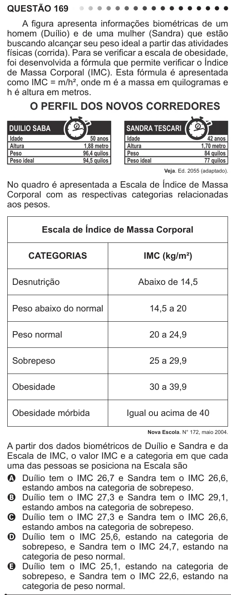

Texto extraído (pode conter ruído)

QUESTÃO 169  
A figura apresenta informações biométricas de um  
homem (Duílio) e de uma mulher (Sandra) que estão  
buscando alcançar seu peso ideal a partir das atividades  
físicas (corrida). Para se verificar a escala de obesidade,  
foi desenvolvida a fórmula que permite verificar o Índice  
de Massa Corporal (IMC). Esta fórmula é apresentada  
como IMC = m/h², onde m é a massa em quilogramas e  
h é altura em metros.  
Veja. Ed. 2055 (adaptado).  
No quadro é apresentada a Escala de Índice de Massa  
Corporal com as respectivas categorias relacionadas  
aos pesos.  
Escala de Índice de Massa Corporal  
CATEGORIAS  
IMC (kg/m²)  
Desnutrição  
Abaixo de 14,5  
Peso abaixo do normal  
14,5 a 20  
Peso normal  
20 a 24,9  
Sobrepeso  
25 a 29,9  
Obesidade  
30 a 39,9  
Obesidade mórbida  
Igual ou acima de 40  
Nova Escola. N° 172, maio 2004.  
A partir dos dados biométricos de Duílio e Sandra e da  
Escala de IMC, o valor IMC e a categoria em que cada  
uma das pessoas se posiciona na Escala são  
A Duílio tem o IMC 26,7 e Sandra tem o IMC 26,6,  
estando ambos na categoria de sobrepeso.  
B Duílio tem o IMC 27,3 e Sandra tem o IMC 29,1,  
estando ambos na categoria de sobrepeso.  
C Duílio tem o IMC 27,3 e Sandra tem o IMC 26,6,  
estando ambos na categoria de sobrepeso.  
D Duílio tem o IMC 25,6, estando na categoria de  
sobrepeso, e Sandra tem o IMC 24,7, estando na  
categoria de peso normal.  
E Duílio tem o IMC 25,1, estando na categoria de  
sobrepeso, e Sandra tem o IMC 22,6, estando na  
categoria de peso normal.

