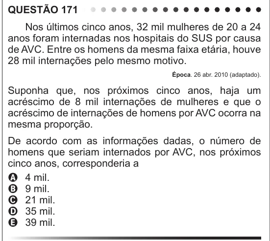

Texto extraído (pode conter ruído)

QUESTÃO 171  
Nos últimos cinco anos, 32 mil mulheres de 20 a 24  
anos foram internadas nos hospitais do SUS por causa  
de AVC. Entre os homens da mesma faixa etária, houve  
28 mil internações pelo mesmo motivo.  
Época. 26 abr. 2010 (adaptado).  
Suponha que, nos próximos cinco anos, haja um  
acréscimo de 8 mil internações de mulheres e que o  
acréscimo de internações de homens por AVC ocorra na  
mesma proporção.  
De acordo com as informações dadas, o número de  
homens que seriam internados por AVC, nos próximos  
cinco anos, corresponderia a  
A 4 mil.  
B 9 mil.  
C 21 mil.  
D 35 mil.  
E 39 mil.

