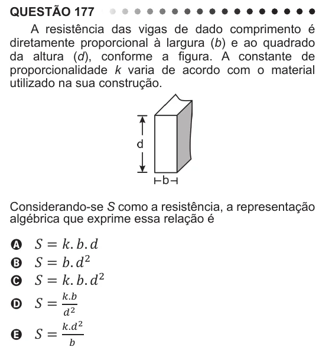

Texto extraído (pode conter ruído)

QUESTÃO 177  
A resistência das vigas de dado comprimento é  
diretamente proporcional à largura (b) e ao quadrado  
da altura (d), conforme a figura. A constante de  
proporcionalidade k varia de acordo com o material  
utilizado na sua construção.  
Considerando-se S como a resistência, a representação  
algébrica que exprime essa relação é  
A ܵ ൌ ݇Ǥ ܾǤ ݀  
B ܵ ൌ ܾǤ ݀ ଶ  
C ܵ ൌ ݇Ǥ ܾǤ ݀ ଶ  
௞Ǥ௕  
D ܵൌ  
ௗ మ  
௞Ǥௗ మ

