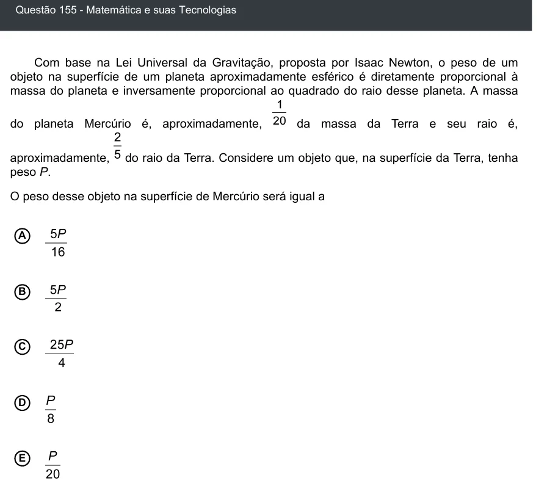

Texto extraído (pode conter ruído)

Questão 155 - Matemática e suas Tecnologias  
Com base na Lei Universal da Gravitação, proposta por Isaac Newton, o peso de um  
objeto na superfície de um planeta aproximadamente esférico é diretamente proporcional à  
massa do planeta e inversamente proporcional ao quadrado do raio desse planeta. A massa  
do planeta Mercúrio é, aproximadamente,  
da massa da Terra e seu raio é,  
aproximadamente,  
do raio da Terra. Considere um objeto que, na superfície da Terra, tenha  
peso P.  
O peso desse objeto na superfície de Mercúrio será igual a  
A  
B  
C  
D  
E

