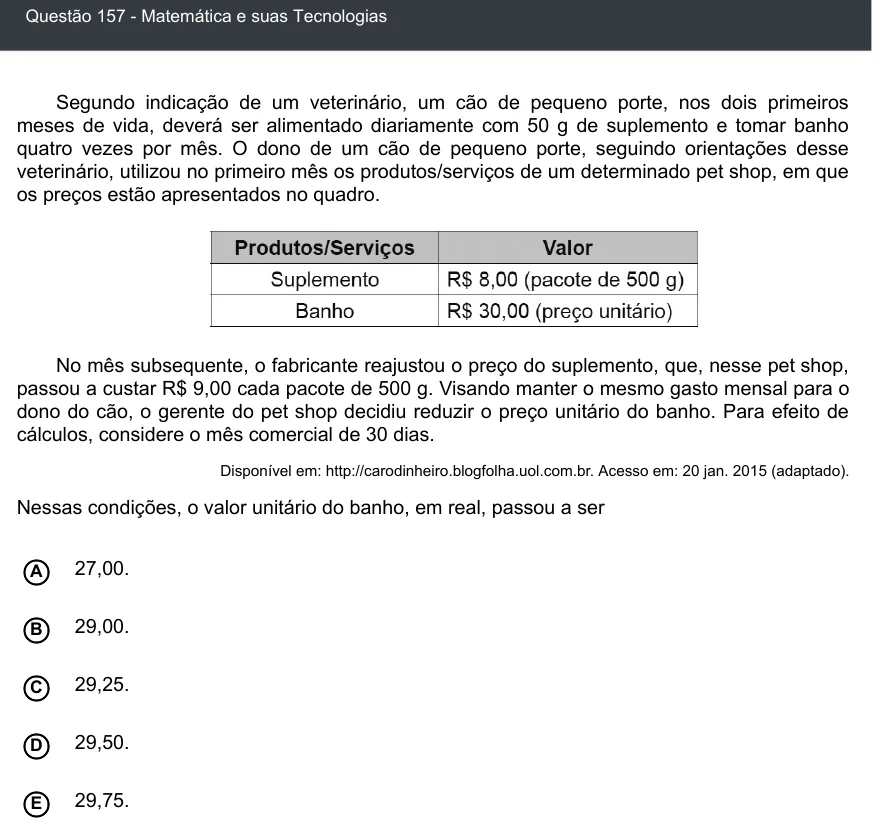

Texto extraído (pode conter ruído)

Questão 157 - Matemática e suas Tecnologias  
Segundo indicação de um veterinário, um cão de pequeno porte, nos dois primeiros  
meses de vida, deverá ser alimentado diariamente com 50 g de suplemento e tomar banho  
quatro vezes por mês. O dono de um cão de pequeno porte, seguindo orientações desse  
veterinário, utilizou no primeiro mês os produtos/serviços de um determinado pet shop, em que  
os preços estão apresentados no quadro.  
No mês subsequente, o fabricante reajustou o preço do suplemento, que, nesse pet shop,  
passou a custar R$ 9,00 cada pacote de 500 g. Visando manter o mesmo gasto mensal para o  
dono do cão, o gerente do pet shop decidiu reduzir o preço unitário do banho. Para efeito de  
cálculos, considere o mês comercial de 30 dias.  
Disponível em: http://carodinheiro.blogfolha.uol.com.br. Acesso em: 20 jan. 2015 (adaptado).  
Nessas condições, o valor unitário do banho, em real, passou a ser  
27,00.  
A  
B  
29,00.  
29,25.  
C  
29,50.  
D  
E  
29,75.

