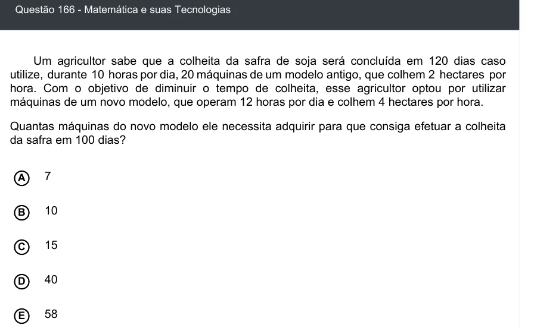

Texto extraído (pode conter ruído)

Questão 166 - Matemática e suas Tecnologias  
Um agricultor sabe que a colheita da safra de soja será concluída em 120 dias caso  
utilize, durante 10 horas por dia, 20 máquinas de um modelo antigo, que colhem 2 hectares por  
hora. Com o objetivo de diminuir o tempo de colheita, esse agricultor optou por utilizar  
máquinas de um novo modelo, que operam 12 horas por dia e colhem 4 hectares por hora.  
Quantas máquinas do novo modelo ele necessita adquirir para que consiga efetuar a colheita  
da safra em 100 dias?  
A  
7  
10  
B  
15  
C  
D  
40  
58  
E

