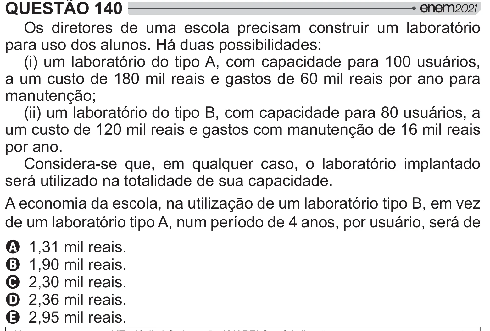

Texto extraído (pode conter ruído)

QUESTÃO 140  
Os diretores de uma escola precisam construir um laboratório  
para uso dos alunos. Há duas possibilidades:  
(i) um laboratório do tipo A, com capacidade para 100 usuários,  
a um custo de 180 mil reais e gastos de 60 mil reais por ano para  
manutenção;  
(ii) um laboratório do tipo B, com capacidade para 80 usuários, a  
um custo de 120 mil reais e gastos com manutenção de 16 mil reais  
por ano.  
Considera-se que, em qualquer caso, o laboratório implantado  
será utilizado na totalidade de sua capacidade.  
A economia da escola, na utilização de um laboratório tipo B, em vez  
de um laboratório tipo A, num período de 4 anos, por usuário, será de  
A 1,31 mil reais.  
B 1,90 mil reais.  
C 2,30 mil reais.  
D 2,36 mil reais.  
E 2,95 mil reais.

