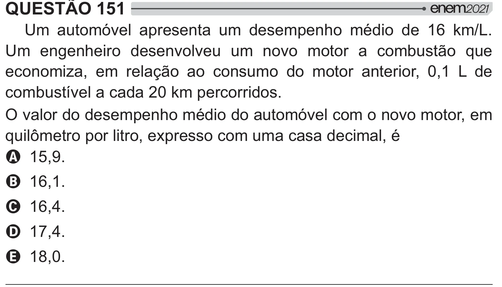

Texto extraído (pode conter ruído)

QUESTÃO 151  
Um automóvel apresenta um desempenho médio de 16 km/L.  
Um engenheiro desenvolveu um novo motor a combustão que  
economiza, em relação ao consumo do motor anterior, 0,1 L de  
combustível a cada 20 km percorridos.  
O valor do desempenho médio do automóvel com o novo motor, em  
2 #  *#  
   <  
A 15,9.  
B 16,1.  
C 16,4.  
D 17,4.  
E 18,0.

