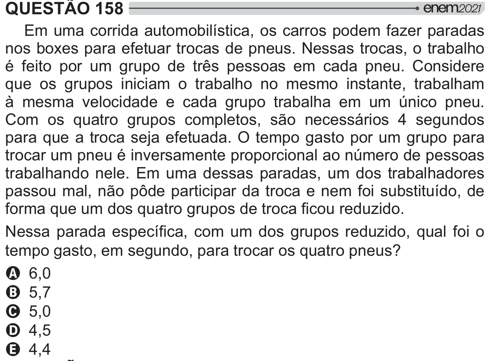

Texto extraído (pode conter ruído)

QUESTÃO 158  
Em uma corrida automobilística, os carros podem fazer paradas  
nos boxes para efetuar trocas de pneus. Nessas trocas, o trabalho  
é feito por um grupo de três pessoas em cada pneu. Considere  
que os grupos iniciam o trabalho no mesmo instante, trabalham  
à mesma velocidade e cada grupo trabalha em um único pneu.  
Com os quatro grupos completos, são necessários 4 segundos  
para que a troca seja efetuada. O tempo gasto por um grupo para  
trocar um pneu é inversamente proporcional ao número de pessoas  
trabalhando nele. Em uma dessas paradas, um dos trabalhadores  
passou mal, não pôde participar da troca e nem foi substituído, de  
>  
     #      !  
ˆ  
 # # {      #      >   
tempo gasto, em segundo, para trocar os quatro pneus?  
A 6,0  
B 5,7  
C 5,0  
D 4,5  
E 4,4

