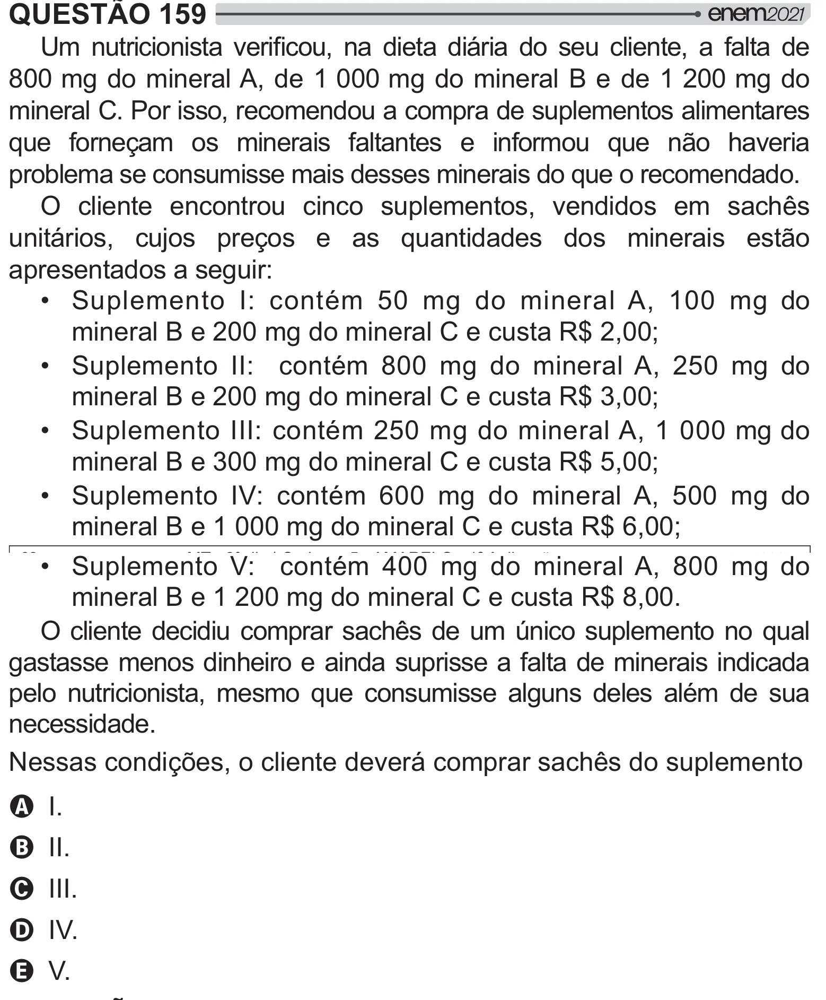

Texto extraído (pode conter ruído)

QUESTÃO 159  
'    "      /   
     >     
800 mg do mineral A, de 1 000 mg do mineral B e de 1 200 mg do  
mineral C. Por isso, recomendou a compra de suplementos alimentares  
que forneçam os minerais faltantes e informou que não haveria  
problema se consumisse mais desses minerais do que o recomendado.  
O cliente encontrou cinco suplementos, vendidos em sachês  
unitários, cujos preços e as quantidades dos minerais estão  
apresentados a seguir:  
• Suplemento I: contém 50 mg do mineral A, 100 mg do  
mineral B e 200 mg do mineral C e custa R$ 2,00;  
• Suplemento II: contém 800 mg do mineral A, 250 mg do  
mineral B e 200 mg do mineral C e custa R$ 3,00;  
• Suplemento III: contém 250 mg do mineral A, 1 000 mg do  
mineral B e 300 mg do mineral C e custa R$ 5,00;  
• Suplemento IV: contém 600 mg do mineral A, 500 mg do  
mineral B e 1 000 mg do mineral C e custa R$ 6,00;  
• Suplemento V: contém 400 mg do mineral A, 800 mg do  
mineral B e 1 200 mg do mineral C e custa R$ 8,00.  
O cliente decidiu comprar sachês de um único suplemento no qual  
gastasse menos dinheiro e ainda suprisse a falta de minerais indicada  
pelo nutricionista, mesmo que consumisse alguns deles além de sua  
necessidade.  
Nessas condições, o cliente deverá comprar sachês do suplemento  
A I.  
B II.  
C III.  
D IV.  
E V.

