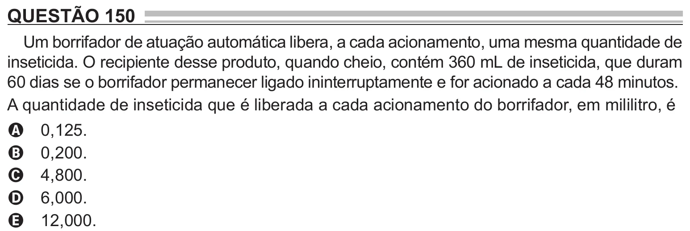

Texto extraído (pode conter ruído)

QUESTÃO 150  
Um borrifador de atuação automática libera, a cada acionamento, uma mesma quantidade de  
inseticida. O recipiente desse produto, quando cheio, contém 360 mL de inseticida, que duram  
60 dias se o borrifador permanecer ligado ininterruptamente e for acionado a cada 48 minutos.  
A quantidade de inseticida que é liberada a cada acionamento do borrifador, em mililitro, é  
0,125.  
A  
0,200.  
B  
4,800.  
C  
6,000.  
D  
12,000.  
E

