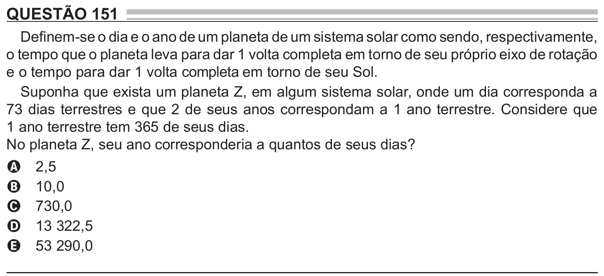

Texto extraído (pode conter ruído)

QUESTÃO 151  
Definem-se o dia e o ano de um planeta de um sistema solar como sendo, respectivamente,  
o tempo que o planeta leva para dar 1 volta completa em torno de seu próprio eixo de rotação  
e o tempo para dar 1 volta completa em torno de seu Sol.  
Suponha que exista um planeta Z, em algum sistema solar, onde um dia corresponda a  
73 dias terrestres e que 2 de seus anos correspondam a 1 ano terrestre. Considere que  
1 ano terrestre tem 365 de seus dias.  
No planeta Z, seu ano corresponderia a quantos de seus dias?  
2,5  
A  
10,0  
B  
730,0  
C  
13 322,5  
D  
53 290,0  
E

