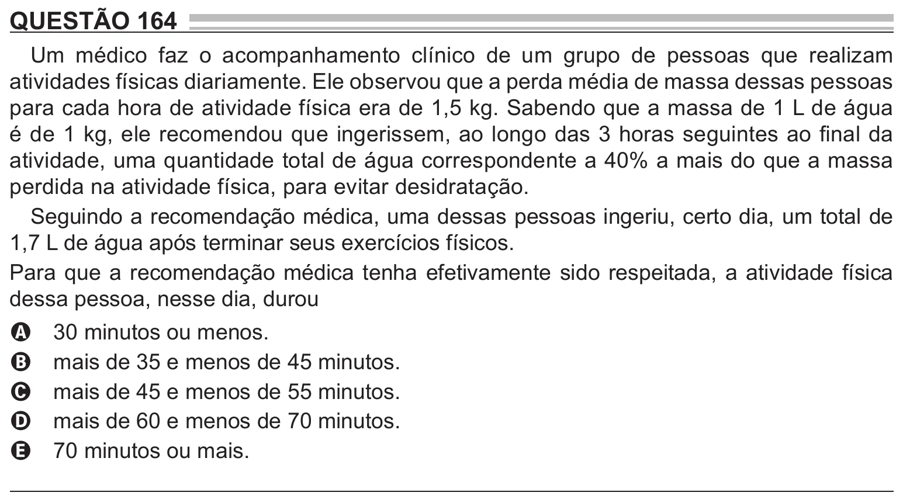

Texto extraído (pode conter ruído)

QUESTÃO 164  
Um médico faz o acompanhamento clínico de um grupo de pessoas que realizam  
atividades físicas diariamente. Ele observou que a perda média de massa dessas pessoas  
para cada hora de atividade física era de 1,5 kg. Sabendo que a massa de 1 L de água  
é de 1 kg, ele recomendou que ingerissem, ao longo das 3 horas seguintes ao final da  
atividade, uma quantidade total de água correspondente a 40% a mais do que a massa  
perdida na atividade física, para evitar desidratação.  
Seguindo a recomendação médica, uma dessas pessoas ingeriu, certo dia, um total de  
1,7 L de água após terminar seus exercícios físicos.  
Para que a recomendação médica tenha efetivamente sido respeitada, a atividade física  
dessa pessoa, nesse dia, durou  
30 minutos ou menos.  
A  
mais de 35 e menos de 45 minutos.  
B  
mais de 45 e menos de 55 minutos.  
C  
mais de 60 e menos de 70 minutos.  
D  
70 minutos ou mais.  
E

