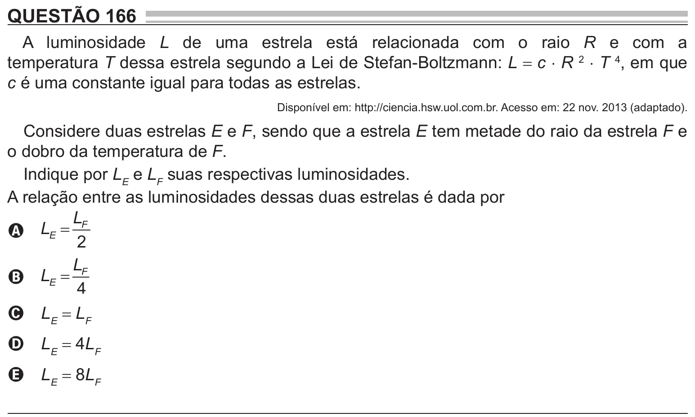

Texto extraído (pode conter ruído)

QUESTÃO 166  
A luminosidade L de uma estrela está relacionada com o raio R e com a  
temperatura T dessa estrela segundo a Lei de Stefan-Boltzmann: L = c ⋅ R 2 ⋅ T 4 , em que  
c é uma constante igual para todas as estrelas.  
Disponível em: http://ciencia.hsw.uol.com.br. Acesso em: 22 nov. 2013 (adaptado).  
Considere duas estrelas E e F, sendo que a estrela E tem metade do raio da estrela F e  
o dobro da temperatura de F.  
Indique por L E e L F suas respectivas luminosidades.  
A relação entre as luminosidades dessas duas estrelas é dada por  
L F  
A L E =  
2  
L  
B L E = F  
4  
C L E = L F  
L E = 4L F  
D  
L E = 8L F  
E

