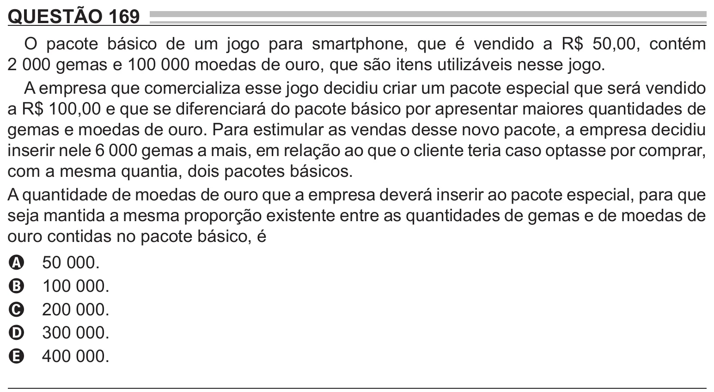

Texto extraído (pode conter ruído)

QUESTÃO 169  
O pacote básico de um jogo para smartphone, que é vendido a R$ 50,00, contém  
2 000 gemas e 100 000 moedas de ouro, que são itens utilizáveis nesse jogo.  
A empresa que comercializa esse jogo decidiu criar um pacote especial que será vendido  
a R$ 100,00 e que se diferenciará do pacote básico por apresentar maiores quantidades de  
gemas e moedas de ouro. Para estimular as vendas desse novo pacote, a empresa decidiu  
inserir nele 6 000 gemas a mais, em relação ao que o cliente teria caso optasse por comprar,  
com a mesma quantia, dois pacotes básicos.  
A quantidade de moedas de ouro que a empresa deverá inserir ao pacote especial, para que  
seja mantida a mesma proporção existente entre as quantidades de gemas e de moedas de  
ouro contidas no pacote básico, é  
50 000.  
A  
100 000.  
B  
200 000.  
C  
300 000.  
D  
400 000.  
E

