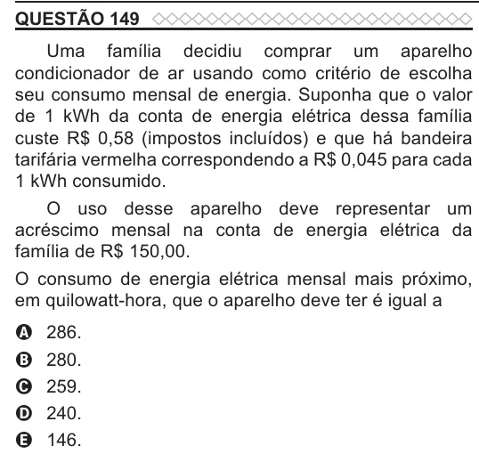

Texto extraído (pode conter ruído)

QUESTÃO 149  
Uma família decidiu comprar um aparelho  
condicionador de ar usando como critério de escolha  
seu consumo mensal de energia. Suponha que o valor  
de 1 kWh da conta de energia elétrica dessa família  
custe R$ 0,58 (impostos incluídos) e que há bandeira  
tarifária vermelha correspondendo a R$ 0,045 para cada  
1 kWh consumido.  
O uso desse aparelho deve representar um  
acréscimo mensal na conta de energia elétrica da  
família de R$ 150,00.  
O consumo de energia elétrica mensal mais próximo,  
em quilowatt-hora, que o aparelho deve ter é igual a  
286.  
A  
280.  
B  
259.  
C  
D  
240.  
146.  
E

