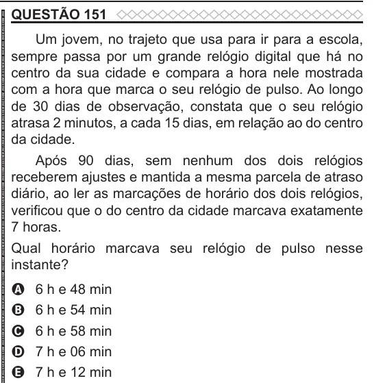

Texto extraído (pode conter ruído)

QUESTÃO 151  
Um jovem, no trajeto que usa para ir para a escola,  
sempre passa por um grande relógio digital que há no  
centro da sua cidade e compara a hora nele mostrada  
com a hora que marca o seu relógio de pulso. Ao longo  
de 30 dias de observação, constata que o seu relógio  
atrasa 2 minutos, a cada 15 dias, em relação ao do centro  
da cidade.  
Após 90 dias, sem nenhum dos dois relógios  
receberem ajustes e mantida a mesma parcela de atraso  
diário, ao ler as marcações de horário dos dois relógios,  
verificou que o do centro da cidade marcava exatamente  
7 horas.  
Qual horário marcava seu relógio de pulso nesse  
instante?  
6 h e 48 min  
A  
B  
6 h e 54 min  
C  
6 h e 58 min  
7 h e 06 min  
D  
7 h e 12 min  
E

