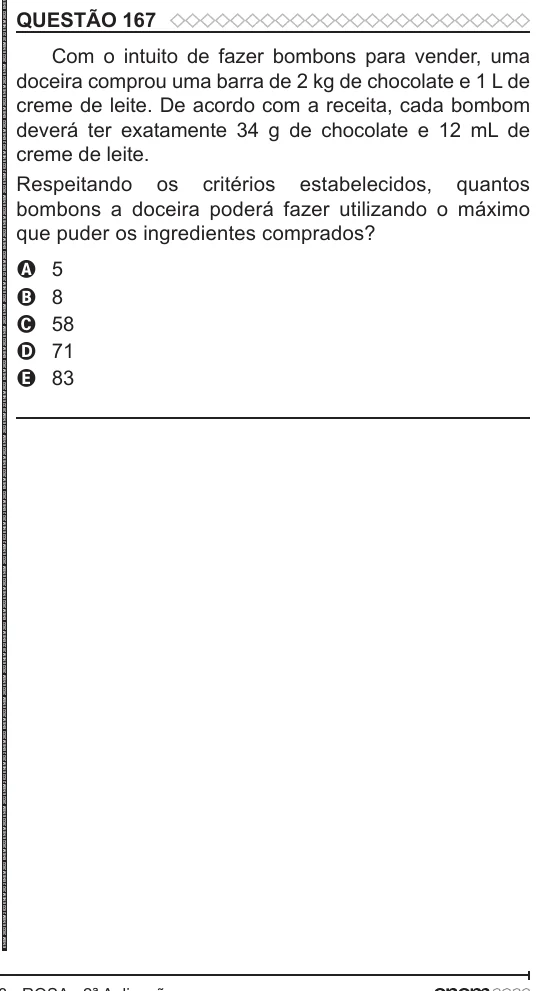

Texto extraído (pode conter ruído)

QUESTÃO 167  
Com o intuito de fazer bombons para vender, uma  
doceira comprou uma barra de 2 kg de chocolate e 1 L de  
creme de leite. De acordo com a receita, cada bombom  
deverá ter exatamente 34 g de chocolate e 12 mL de  
creme de leite.  
Respeitando os critérios estabelecidos, quantos  
bombons a doceira poderá fazer utilizando o máximo  
que puder os ingredientes comprados?  
5  
A  
8  
B  
58  
C  
71  
D  
E  
83

