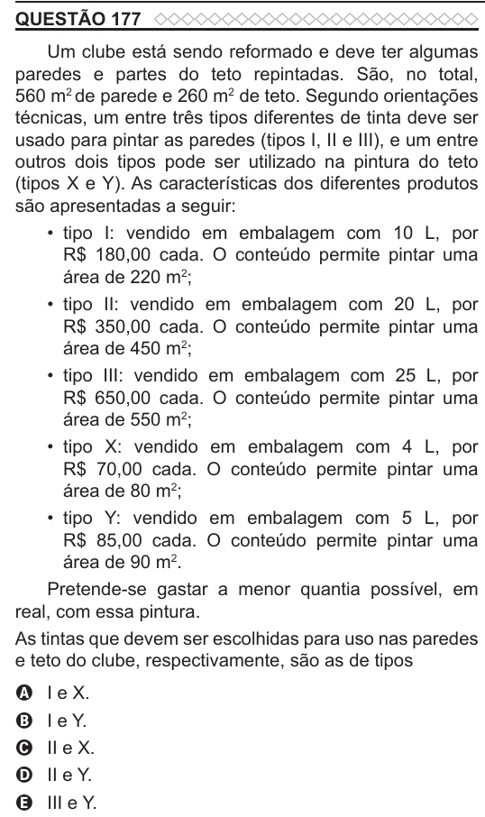

Texto extraído (pode conter ruído)

QUESTÃO 177  
Um clube está sendo reformado e deve ter algumas  
paredes e partes do teto repintadas. São, no total,  
560 m 2 de parede e 260 m 2 de teto. Segundo orientações  
técnicas, um entre três tipos diferentes de tinta deve ser  
usado para pintar as paredes (tipos I, II e III), e um entre  
outros dois tipos pode ser utilizado na pintura do teto  
(tipos X e Y). As características dos diferentes produtos  
são apresentadas a seguir:  
• tipo I: vendido em embalagem com 10 L, por  
R$ 180,00 cada. O conteúdo permite pintar uma  
área de 220 m 2 ;  
• tipo II: vendido em embalagem com 20 L, por  
R$ 350,00 cada. O conteúdo permite pintar uma  
área de 450 m 2 ;  
• tipo III: vendido em embalagem com 25 L, por  
R$ 650,00 cada. O conteúdo permite pintar uma  
área de 550 m 2 ;  
• tipo X: vendido em embalagem com 4 L, por  
R$ 70,00 cada. O conteúdo permite pintar uma  
área de 80 m 2 ;  
• tipo Y: vendido em embalagem com 5 L, por  
R$ 85,00 cada. O conteúdo permite pintar uma  
área de 90 m 2 .  
Pretende-se gastar a menor quantia possível, em  
real, com essa pintura.  
As tintas que devem ser escolhidas para uso nas paredes  
e teto do clube, respectivamente, são as de tipos  
I e X.  
A  
I e Y.  
B  
II e X.  
C  
II e Y.  
D  
E  
III e Y.

