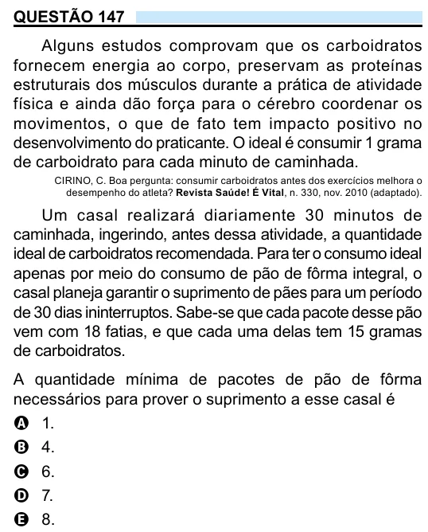

Texto extraído (pode conter ruído)

QUESTÃO 147  
Alguns estudos comprovam que os carboidratos  
fornecem energia ao corpo, preservam as proteínas  
estruturais dos músculos durante a prática de atividade  
física e ainda dão força para o cérebro coordenar os  
movimentos, o que de fato tem impacto positivo no  
desenvolvimento do praticante. O ideal é consumir 1 grama  
de carboidrato para cada minuto de caminhada.  
CIRINO, C. Boa pergunta: consumir carboidratos antes dos exercícios melhora o  
desempenho do atleta? Revista Saúde! É Vital, n. 330, nov. 2010 (adaptado).  
Um casal realizará diariamente 30 minutos de  
caminhada, ingerindo, antes dessa atividade, a quantidade  
ideal de carboidratos recomendada. Para ter o consumo ideal  
apenas por meio do consumo de pão de fôrma integral, o  
casal planeja garantir o suprimento de pães para um período  
de 30 dias ininterruptos. Sabe-se que cada pacote desse pão  
vem com 18 fatias, e que cada uma delas tem 15 gramas  
de carboidratos.  
A quantidade mínima de pacotes de pão de fôrma  
necessários para prover o suprimento a esse casal é  
A 1.  
B 4.  
C 6.  
D 7.  
E 8.

