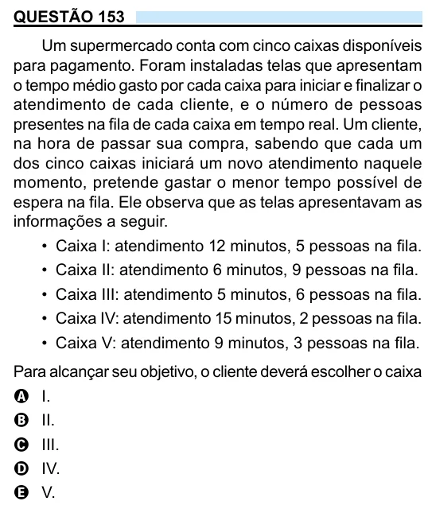

Texto extraído (pode conter ruído)

QUESTÃO 153  
Um supermercado conta com cinco caixas disponíveis  
para pagamento. Foram instaladas telas que apresentam  
o tempo médio gasto por cada caixa para iniciar e finalizar o  
atendimento de cada cliente, e o número de pessoas  
presentes na fila de cada caixa em tempo real. Um cliente,  
na hora de passar sua compra, sabendo que cada um  
dos cinco caixas iniciará um novo atendimento naquele  
momento, pretende gastar o menor tempo possível de  
espera na fila. Ele observa que as telas apresentavam as  
informações a seguir.  
• Caixa I: atendimento 12 minutos, 5 pessoas na fila.  
• Caixa II: atendimento 6 minutos, 9 pessoas na fila.  
• Caixa III: atendimento 5 minutos, 6 pessoas na fila.  
• Caixa IV: atendimento 15 minutos, 2 pessoas na fila.  
• Caixa V: atendimento 9 minutos, 3 pessoas na fila.  
Para alcançar seu objetivo, o cliente deverá escolher o caixa  
A I.  
B II.  
C III.  
D IV.  
E V.

