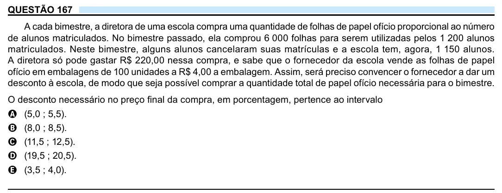

Texto extraído (pode conter ruído)

QUESTÃO 167  
A cada bimestre, a diretora de uma escola compra uma quantidade de folhas de papel ofício proporcional ao número  
de alunos matriculados. No bimestre passado, ela comprou 6 000 folhas para serem utilizadas pelos 1 200 alunos  
matriculados. Neste bimestre, alguns alunos cancelaram suas matrículas e a escola tem, agora, 1 150 alunos.  
A diretora só pode gastar R$ 220,00 nessa compra, e sabe que o fornecedor da escola vende as folhas de papel  
ofício em embalagens de 100 unidades a R$ 4,00 a embalagem. Assim, será preciso convencer o fornecedor a dar um  
desconto à escola, de modo que seja possível comprar a quantidade total de papel ofício necessária para o bimestre.  
O desconto necessário no preço final da compra, em porcentagem, pertence ao intervalo  
A (5,0 ; 5,5).  
B (8,0 ; 8,5).  
C (11,5 ; 12,5).  
D (19,5 ; 20,5).  
E (3,5 ; 4,0).

