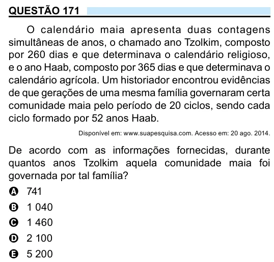

Texto extraído (pode conter ruído)

QUESTÃO 171  
O calendário maia apresenta duas contagens  
simultâneas de anos, o chamado ano Tzolkim, composto  
por 260 dias e que determinava o calendário religioso,  
e o ano Haab, composto por 365 dias e que determinava o  
calendário agrícola. Um historiador encontrou evidências  
de que gerações de uma mesma família governaram certa  
comunidade maia pelo período de 20 ciclos, sendo cada  
ciclo formado por 52 anos Haab.  
Disponível em: www.suapesquisa.com. Acesso em: 20 ago. 2014.  
De acordo com as informações fornecidas, durante  
quantos anos Tzolkim aquela comunidade maia foi  
governada por tal família?  
A 741  
B 1 040  
C 1 460  
D 2 100  
E 5 200

