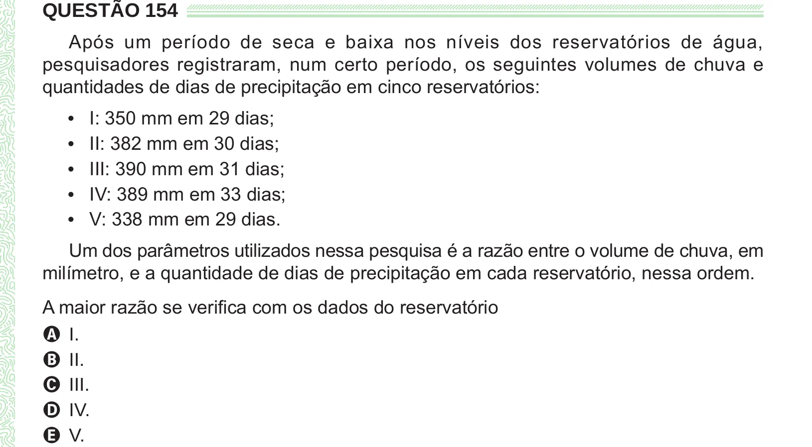

Texto extraído (pode conter ruído)

QUESTÃO 154  
Após um período de seca e baixa nos níveis dos reservatórios de água,  
pesquisadores registraram, num certo período, os seguintes volumes de chuva e  
quantidades de dias de precipitação em cinco reservatórios:  
I: 350 mm em 29 dias;  
•  
II: 382 mm em 30 dias;  
•  
III: 390 mm em 31 dias;  
•  
IV: 389 mm em 33 dias;  
•  
V: 338 mm em 29 dias.  
•  
Um dos parâmetros utilizados nessa pesquisa é a razão entre o volume de chuva, em  
milímetro, e a quantidade de dias de precipitação em cada reservatório, nessa ordem.  
A maior razão se verifica com os dados do reservatório  
A I.  
B II.  
C III.  
D IV.  
E V.

