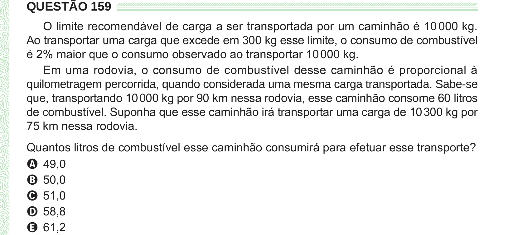

Texto extraído (pode conter ruído)

QUESTÃO 159  
O limite recomendável de carga a ser transportada por um caminhão é 10 000 kg.  
Ao transportar uma carga que excede em 300 kg esse limite, o consumo de combustível  
é 2% maior que o consumo observado ao transportar 10 000 kg.  
Em uma rodovia, o consumo de combustível desse caminhão é proporcional à  
quilometragem percorrida, quando considerada uma mesma carga transportada. Sabe-se  
que, transportando 10 000 kg por 90 km nessa rodovia, esse caminhão consome 60 litros  
de combustível. Suponha que esse caminhão irá transportar uma carga de 10 300 kg por  
75 km nessa rodovia.  
Quantos litros de combustível esse caminhão consumirá para efetuar esse transporte?  
A 49,0  
B 50,0  
C 51,0  
D 58,8  
E 61,2

