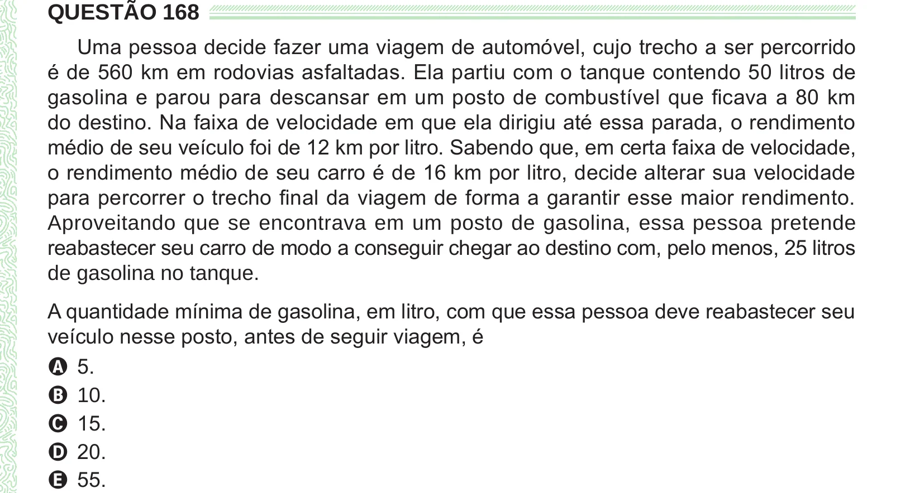

Texto extraído (pode conter ruído)

QUESTÃO 168  
Uma pessoa decide fazer uma viagem de automóvel, cujo trecho a ser percorrido  
é de 560 km em rodovias asfaltadas. Ela partiu com o tanque contendo 50 litros de  
gasolina e parou para descansar em um posto de combustível que ficava a 80 km  
do destino. Na faixa de velocidade em que ela dirigiu até essa parada, o rendimento  
médio de seu veículo foi de 12 km por litro. Sabendo que, em certa faixa de velocidade,  
o rendimento médio de seu carro é de 16 km por litro, decide alterar sua velocidade  
para percorrer o trecho final da viagem de forma a garantir esse maior rendimento.  
Aproveitando que se encontrava em um posto de gasolina, essa pessoa pretende  
reabastecer seu carro de modo a conseguir chegar ao destino com, pelo menos, 25 litros  
de gasolina no tanque.  
A quantidade mínima de gasolina, em litro, com que essa pessoa deve reabastecer seu  
veículo nesse posto, antes de seguir viagem, é  
A 5.  
B 10.  
C 15.  
D 20.  
E 55.

