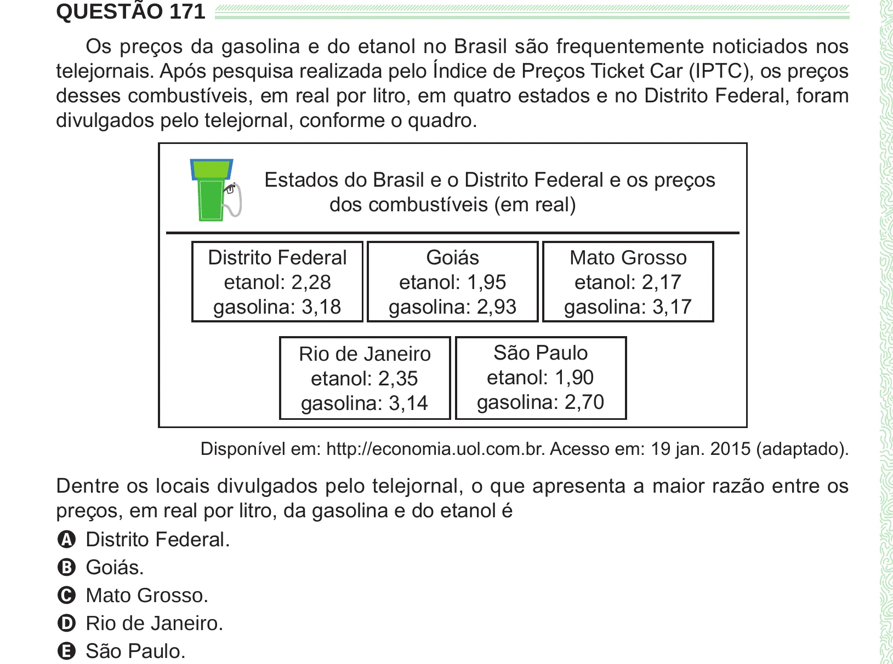

Texto extraído (pode conter ruído)

QUESTÃO 171  
Os preços da gasolina e do etanol no Brasil são frequentemente noticiados nos  
telejornais. Após pesquisa realizada pelo Índice de Preços Ticket Car (IPTC), os preços  
desses combustíveis, em real por litro, em quatro estados e no Distrito Federal, foram  
divulgados pelo telejornal, conforme o quadro.  
Estados do Brasil e o Distrito Federal e os preços  
dos combustíveis (em real)  
Distrito Federal  
Goiás  
Mato Grosso  
etanol: 1,95  
etanol: 2,17  
etanol: 2,28  
gasolina: 3,18  
gasolina: 2,93  
gasolina: 3,17  
São Paulo  
Rio de Janeiro  
etanol: 2,35  
etanol: 1,90  
gasolina: 3,14  
gasolina: 2,70  
Disponível em: http://economia.uol.com.br. Acesso em: 19 jan. 2015 (adaptado).  
Dentre os locais divulgados pelo telejornal, o que apresenta a maior razão entre os  
preços, em real por litro, da gasolina e do etanol é  
A Distrito Federal.  
B Goiás.  
C Mato Grosso.  
D Rio de Janeiro.  
E São Paulo.

