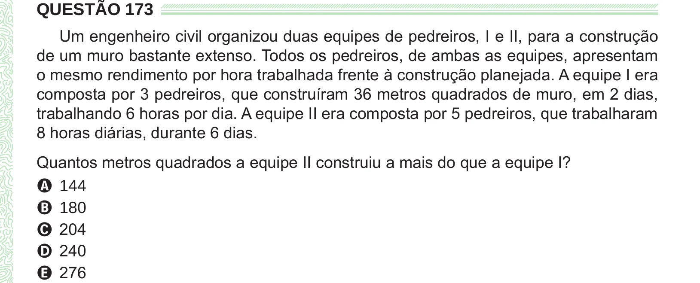

Texto extraído (pode conter ruído)

QUESTÃO 173  
Um engenheiro civil organizou duas equipes de pedreiros, I e II, para a construção  
de um muro bastante extenso. Todos os pedreiros, de ambas as equipes, apresentam  
o mesmo rendimento por hora trabalhada frente à construção planejada. A equipe I era  
composta por 3 pedreiros, que construíram 36 metros quadrados de muro, em 2 dias,  
trabalhando 6 horas por dia. A equipe II era composta por 5 pedreiros, que trabalharam  
8 horas diárias, durante 6 dias.  
Quantos metros quadrados a equipe II construiu a mais do que a equipe I?  
A 144  
B 180  
C 204  
D 240  
E 276

