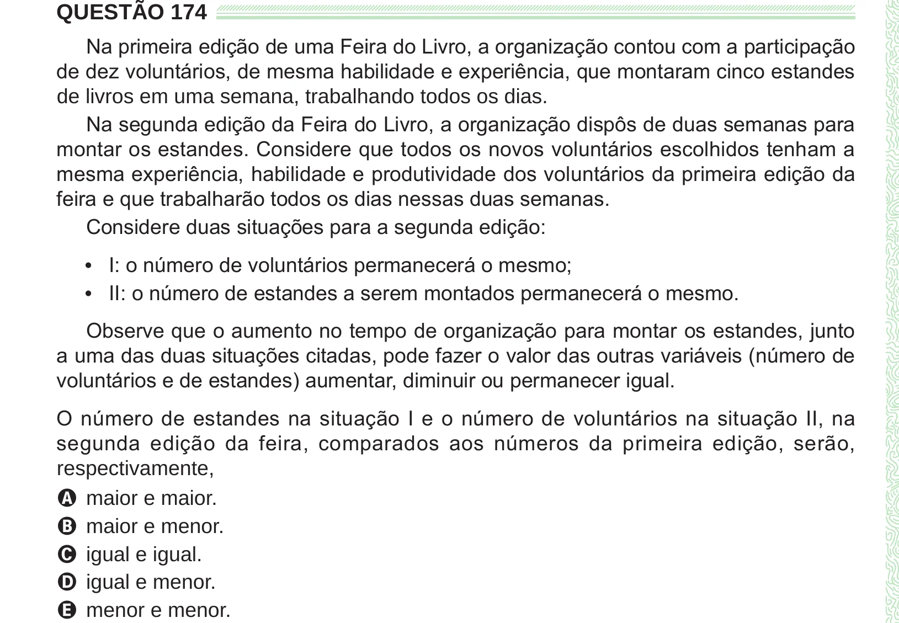

Texto extraído (pode conter ruído)

QUESTÃO 174  
Na primeira edição de uma Feira do Livro, a organização contou com a participação  
de dez voluntários, de mesma habilidade e experiência, que montaram cinco estandes  
de livros em uma semana, trabalhando todos os dias.  
Na segunda edição da Feira do Livro, a organização dispôs de duas semanas para  
montar os estandes. Considere que todos os novos voluntários escolhidos tenham a  
mesma experiência, habilidade e produtividade dos voluntários da primeira edição da  
feira e que trabalharão todos os dias nessas duas semanas.  
Considere duas situações para a segunda edição:  
• I: o número de voluntários permanecerá o mesmo;  
• II: o número de estandes a serem montados permanecerá o mesmo.  
Observe que o aumento no tempo de organização para montar os estandes, junto  
a uma das duas situações citadas, pode fazer o valor das outras variáveis (número de  
voluntários e de estandes) aumentar, diminuir ou permanecer igual.  
O número de estandes na situação I e o número de voluntários na situação II, na  
segunda edição da feira, comparados aos números da primeira edição, serão,  
respectivamente,  
A maior e maior.  
B maior e menor.  
C igual e igual.  
D igual e menor.  
E menor e menor.

