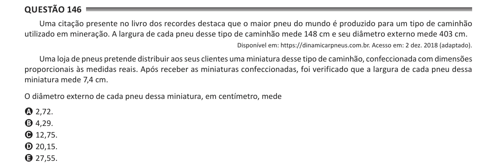

Texto extraído (pode conter ruído)

Questão 146  
Uma citação presente no livro dos recordes destaca que o maior pneu do mundo é produzido para um tipo de caminhão  
utilizado em mineração. A largura de cada pneu desse tipo de caminhão mede 148 cm e seu diâmetro externo mede 403 cm.  
Disponível em: https://dinamicarpneus.com.br. Acesso em: 2 dez. 2018 (adaptado).  
Uma loja de pneus pretende distribuir aos seus clientes uma miniatura desse tipo de caminhão, confeccionada com dimensões  
proporcionais às medidas reais. Após receber as miniaturas confeccionadas, foi verificado que a largura de cada pneu dessa  
miniatura mede 7,4 cm.  
O diâmetro externo de cada pneu dessa miniatura, em centímetro, mede  
A 2,72.  
B 4,29.  
C 12,75.  
D 20,15.  
E 27,55.

